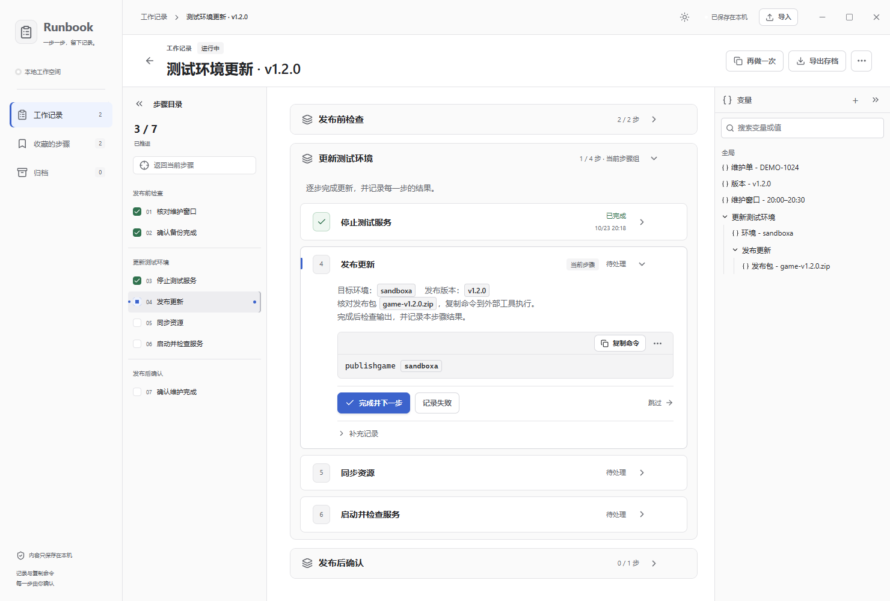

# Runbook

**可复用的操作流程与工作记录**

Runbook 是一款 Windows 桌面工具，用于服务器维护、版本发布、环境更新等需要逐步确认的工作。将步骤、命令和参数整理在一起，在外部工具完成操作后记录结果，下次从已有工作“再做一次”。

## 界面预览

图中使用虚构维护示例。支持浅色与深色主题，长流程可通过左侧目录快速定位，右侧集中查看和填写变量。

## 核心功能

- **整理流程**：自由编辑步骤、说明和命令，按步骤组组织工作。环境、版本、区服等信息可以设为全局或局部变量，集中填参，并查找引用位置。一键复制替换好参数的命令，到外部工具执行。
- **记录过程**：按顺序标记完成、失败或跳过，补充原因、评论和截图。每条结果保留当时的内容、参数与时间，后续调整不会覆盖过去的结果。工作保存在本地，可归档，也可完整导出、导入记录及图片。
- **重复使用**：从任意已有工作点击“再做一次”，创建可独立调整的新工作，带入上次参数供本次核对，重新记录执行结果。也可以收藏常用步骤或步骤组，在其他工作中插入使用。

## 获取方式

目前提供源码，可按照[本地构建说明](CONTRIBUTING.md#本地开发)生成 Windows 桌面程序。首次体验可从仓库中的[维护示例](templates/release-maintenance/README.md)开始。

## 文档与贡献

了解实现、参与开发或验证交互，可阅读[开发约定](CONTRIBUTING.md)、[整体架构](docs/architecture.md)和[测试说明](docs/testing.md)。通过 [Issues](https://github.com/BinBrian/runbook/issues) 反馈问题时，附上复现步骤及经过匿名化的截图，便于定位。

本项目采用 [MIT 许可证](LICENSE)。
