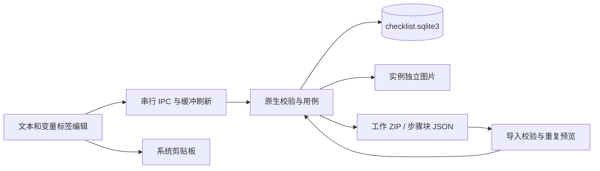

# 清单版整体架构

Tauri 2 与 React 桌面壳继续使用，内容与状态不依赖旧 Markdown 模型。当前迭代已实现全局/局部参数和单层可复用步骤块，原生定向验证、最终真实桌面闭环及两次正常退出重启验收通过。旧版文档在 [history/markdown-v0.1](history/markdown-v0.1/README.md)，基础决策为 [ADR 0008](decisions/0008-json-content-and-optional-ai.md)，当前格式与边界见 [参数作用域与步骤块契约](scoped-blocks-implementation.md) 和 [ADR 0009](decisions/0009-scopes-and-reusable-blocks.md)。

## 工作记录与复用

产品不再建立独立模板层级。WorkLibrary 提供工作记录/归档，FavoritesLibrary 提供收藏；create_work 直接创建独立工作，repeat_work 从来源工作复制文档及已应用值（或默认值），始终生成 draft、空记录和新的操作生命周期。来源仅溯源，不同步，不继承评论、图片、结果或归档。内部 Instance/kind=instance 沿用完整存档契约，见 ADR 0013。

checklist_load_work 返回 {workspace, convertedTemplates}：原生 work_workspace 将旧清单模板转换为未开始工作，并在同一事务的 checklist_work_migrations 表保存原始工作区正文及身份映射，再提交新工作区；冲突生成新工作身份，已有工作不变。空模板集合不会重复转换，删除后不复生。前端据映射重定向旧表单/名称草稿；旧模板 JSON 在导入预览阶段归一为工作，再走原完整导入事务。旧模板 DTO/方法仅用于历史读取和旧测试，不提供产品创建阶层。

## 模块与权威

| 模块 | 职责 |
| --- | --- |
| `apps/desktop/src/checklist/` | 文本片段/标签编辑、参数就近填写、组编辑和块库、当前步骤、历史和补充材料 |
| `checklist/api.ts` | IPC 类型边界、全局串行队列、编辑缓冲刷新、关闭保护、系统剪贴板 |
| `checklist/StepNavigator.tsx` | 左侧步骤状态/进度、只读快照预览、正文内部定位与阅读位置同步；不发业务写入动作 |
| `checklist/StepActions.tsx` | 步骤/组左侧基础增删、右侧细项菜单和复用块选择，共用视口定位、焦点及滚动保护；通过调用方进入原有文档缓冲保存 |
| `checklist/ArtifactDeletion.tsx` | 按保存后的实体身份/名称确认整项删除，目标草稿检查、取消/忙碌焦点保护、错误重试及成功回列表 |
| `checklist/VariablePanel.tsx` / `useVariableScope.ts` | 固定右侧的全局/组/步骤变量、浏览与编辑上下文、定义新增/修改、实例草稿与按范围操作、默认/已应用/历史值展示，通过既有缓冲/动作回调保存 |
| `checklist/VariableEditing.tsx` / `InlineEditable.tsx` | 当前字段的有效选区桥、双击/键盘就地编辑、只读与空占位；变量按身份复用并再次校验可见作用域 |
| `checklist/WindowControls.tsx` | 一体化顶栏原生窗口控制、最大化状态与监听清理；关闭仍走原有保存保护 |
| `apps/desktop/src-tauri/` | 启动诊断、数据目录、单实例、IPC 调度、原生文件对话框 |
| `native/runbook-checklist/src/model.rs` | 模板、实例、块定义、作用域、动作和结果快照 DTO |
| `validate.rs` | 结构、参数可见性、组连续性、块自包含、记录顺序、冻结快照及存档边界 |
| `store.rs` | 用例、SQLite 事务、图片读写、导入预览与提交 |
| `archive.rs` | 模板/块 JSON 与实例 ZIP 的完整打包和验证 |

原生 DTO 与用例是持久化、冻结和进度的最终裁决。前端 `types.ts` 表达同一 camelCase IPC 契约，模型/API测试和真实 WebView2 闭环检查边界；旧 `generated.ts` 仍属于旧版，不参与新清单业务。

Windows 主窗口关闭系统 decorations，保留调整尺寸与阴影。现有应用顶栏和左栏顶部空白接入 Tauri 原生拖动区域，操作区排除拖动；窗口控制只开放所需原生权限。关闭按钮在保存处理注册后可用，发送 close 请求，统一刷新正文并保存本机草稿后退出，按钮不能自行跳过保存。仅真实写入失败提供重试或明确放弃后关闭。详见 [ADR 0010](decisions/0010-integrated-window-titlebar.md) 及 [ADR 0012](decisions/0012-local-drafts-and-close.md)。

`checklist/drafts.ts` 管理版本化显式草稿，`ui-hooks.ts` 订阅恢复；变量定义、实例参数、评论及对话框输入携带原对象/步骤身份，逐次输入同步写入 localStorage，关闭再次刷新。WebView2 profile 由原生层固定到所选数据目录的 webview/，不同目录独立，不新增业务表或存档字段。格式及值形状需验证，不可读原始草稿不能被空值覆盖；写入失败保留内存输入并向 UI 报告。`DraftMenu` 定位原对象和步骤，不自动应用；`CloseFailureDialog` 为真实写入错误提供有损退出选择。业务数据仍以原生 SQLite 为权威。

## 数据流

前端只请求业务动作，不直接写 SQL 或任意文件。原生互斥锁串行访问单连接；数据与文件操作通过阻塞任务线程执行。SQLite 事务确认后返回新 Workspace，失败不发布未保存的状态。

## 内容、历史与参数

TextParts 是普通字符串与 `{parameterId}` 的数组，标题、说明、命令使用同一表达。原本命令中的花括号是普通文字，不会因看似占位符而自动求值。标签只在用户选区转换时产生，JSON 不是产品编辑界面。

标题与描述默认展示，双击或键盘原位编辑。新步骤标题 `['']` 与空组名是真实内容，灰色占位只属于视图；组名仍受 UTF-8 长度及 NUL 校验，其它实体和参数名称仍必填。右侧变量面板只在原字段和保存的 Range 仍有效、作用域可见时复用，不以名称匹配或退回任意插入点；上下文随编辑/阅读位置变化，独立于执行位置。实例在面板中编辑草稿，已应用内容与草稿分开展示，历史展示结果快照。定义保存沿用文档缓冲，值提交沿用按范围显式应用；默认值与本次值不混用。缺失参数定位只更新面板上下文并聚焦其内部输入，不滚动正文。

Parameter 的可选 `ownerId` 明确参数归属；无归属为全局，有归属为步骤或组局部。每个步骤只看得到全局、本步骤及所属组参数，始终按唯一参数身份绑定，名称相同不造成隐式引用。值仍统一按参数身份保存于实例 `parameterValues`，界面按所属范围呈现与显式应用。Document 中 `groups` 保存单层组定义，Step 的 `groupId` 表示归属；同组成员必须连续，平铺步骤数组仍决定唯一执行顺序。

实例携带自己的文档、参数定义和本次值。每条结果保存已经替换的标题、说明、命令与参数值。完成/跳过形成冻结前缀；当前步骤身份、位置及所属组固定，未来步骤及完整未来组可增删重排。已推进步骤所属组的定义冻结，部分推进组内尚未推进的步骤仍可调整；失败快照独立保留，当前内容可以继续调整。

步骤局部值在本步推进后冻结，组局部值在其全部步骤推进后冻结。全局值及部分推进组的局部值可为后续工作显式修改，不重写旧快照。参数定义的冻结范围为已推进步骤引用过的参数、已推进步骤拥有的局部参数、已完整推进组拥有的局部参数；仅未来步骤引用的组局部定义可以继续编辑。

status 与 archivedAt 独立。draft 开始前填参；in_progress 按当前步骤推进；completed/terminated 不恢复执行；补充材料仍可管理。工作副本回到 draft，存档副本保留原状态。

## 块定义与使用副本

底层 Workspace 沿用 `templates`、`instances`、`blocks` 契约；工作入口转换后 templates 为空，instances 是唯一工作记录集合。BlockDefinition 复用模板字段，`kind=block`、`formatVersion=2`，必须恰有一个组，所有步骤归该组、所有参数归该组或组内步骤。原生拒绝缺失 owner、跨组引用及外部全局依赖。

块库保存可复用的内容和参数定义，不保存实例填值或执行记录。从组保存为块时，前端收集组内局部参数和引用到的全局定义，保留原默认值，将全局捕获为块内局部参数并重绑身份。插入块或复制组时再创建新的组、步骤、命令、局部参数身份，插入后的文档通过正常保存动作提交原生校验。`sourceBlockId` 仅溯源；库改动、删除不修改使用副本，实例存档恢复不查询块库。

## 存储和故障边界

新库单行保存结构化 Workspace，保留简单的本地用例与事务模型，适合首版个人小规模使用。图片按实例身份独立保存；导入先完整校验，写入图片后提交数据库，失败清理本次新写文件。删除图片条目在事务确认后清理对应文件；意外残留的孤立文件暂不做全库定时回收。

`delete_template` 只事务移除模板定义，`delete_instance` 事务移除该实例及其全部文档、值和记录，二者均保留其他对象及其来源标识，不改变数据库表结构或存档格式。实例删除支持全部状态和归档归属，前端确认前后均刷新缓冲并检查目标自己的显式草稿；其他对象未提交输入独立保留。确认对话框与工作区使用不同 React key 命名空间，避免删除时错误复用兄弟节点。

实例删除在事务成功后仅逐个尽力清理原登记图片，不递归删除目录；校验身份和相对路径，拒绝路径组件中的符号链接及 Windows reparse/junction，并检查 canonical 路径仍属于该实例。事务失败不碰图片；文件清理失败不把已提交删除伪报失败，允许留下无引用文件，沿用单图片删除的事务后清理语义。未登记文件和其他实例图片保持不变。

新对象、变更目标、导入目标与导出使用 v2。既有清单 v1 保持可读，缺省 `groups` 和 `blocks` 为空、参数为全局，读取不自动重写数据库正文。保存只升级所变更目标，导出只升级输出副本；原来的结果数组和快照保持原样。工作入口首次加载后提供补丁示例工作及更新重启、玩家转区两个块；已有库缺少块集合时按空集合读取，不为填充样例而自动写入。

新 `checklist.sqlite3` 与旧库并存，不迁移旧 Markdown 记录；已有清单模板按上方显式事务转换并保留原文备份。保持显式路径优先级和启动错误反馈，配置无效不静默切换。导出使用临时文件及原子替换，缺失图片时拒绝交付不完整存档。

当前无多窗口协同、分页、大工作区性能保证、断电零丢失承诺。作用域/步骤块已通过隔离桌面完整存档及两次正常退出重启验收；故障及真实维护效率另行验证。

## 扩展

工作流程内容参考 [document.schema.json](schema/document.schema.json)，不要求模板包装。结构合法仍需原生引用/状态校验与人工内容核对。未来 AI 可以生成工作内容草稿或建议本次参数，经用户确认后采用，支持自行配置远程或本地服务。本轮不引入模型请求、服务凭据或自动命令执行。

## 收藏快照与合组

收藏交互与格式见 ADR 0014。FavoritesLibrary 是搜索和只读预览，FavoriteDialog 通过 capture_favorite 将已保存工作/步骤或组身份发往原生 favorite::capture；它只读取定义，重建自包含身份并存入 Workspace.blocks。rename_favorite 仅改收藏名称。可选 favorite 元信息保留类型与来源；单步存储包装组在 insertBlock 时解包。旧块无元信息按组收藏使用。收藏页不挂载 DocumentEditor，内容编辑统一回工作。

step-selection.ts 根据当前状态计算可选步骤并验证连续性，合组保持原步骤/命令/参数 ID，只新增组，经现有保存缓冲和原生冻结校验提交。选择状态不持久化；收藏名称和更新目标走版本化本机显式草稿，可正常关闭恢复。

## 紧凑变量树与统一搜索

自动推进在 useLayoutEffect 中先调用 useStepJump 捕获下一步卡片或所属组的原视口锚点，再提交展开/收起。定位器补偿同一锚点的布局位移，临时关闭 overflow-anchor，目标与正文尺寸连续帧稳定后启动原生 smooth；若动画期间布局再次变化，停止旧目标并重新稳定定位。新请求、主动滚轮/触摸/正文操作及卸载清理旧任务并恢复样式；只滚正文。首次进入和减少动态效果使用 instant，手动目录/引用定位默认 smooth。实际结果仍先刷新编辑缓冲再经原生提交，不改业务数据与冻结规则。

PartsView 在提供已应用值的展示场景中按现有 trim 缺失语义设置 data-variable-missing：缺值仅显示定义名称、虚线边框与 title/aria-description 提示，非空值原样显示。定义预览未提供值不推断缺失；快照仍走原冻结纯文本路径。高亮伪元素依据同一缺值属性切换虚/实线，未应用参数草稿不会提前影响正文。仅属视图，不写入 TextParts、参数或结果。

VariablePanel 展示整份工作，以 variableBranches 建立根级全局叶项及组/步骤分支；选中、折叠和编辑模式仅属视图，持久化仍使用原有值草稿与定义表单。名称和值自然相邻，双击或菜单修改值才挂载输入，恢复参数草稿也会打开正确字段。VariableMenu 将管理操作门户渲染到视口，焦点、键盘、外部点击和滚动重定位独立于正文。正文移除 VariableStepSearch 的挂载。

右侧搜索由工作级 searchState 控制；matchingVariableIds 按命名空间/说明/显示值找稳定 ID，再由 referencingSteps 找标题/说明/命令的真实引用。缺失标签继续携带精确 ID，筛选不按同名跨组绑定，不改变步骤顺序或应用范围。variableHistory 为全局/组/步骤选择对应冻结值，其他未来作用域不会因浏览历史而误锁；实际变更仍由原生决定，不改 SQLite 或存档格式。

2026-10-22 单击引用定位：叶项直接复用稳定 ID 搜索及正文展开/滚动，保留变量上下文以区分历史浏览和当前值编辑。点击时缓存当前可见树身份集合并保留折叠位置；手动查询仍重新过滤。引用步数与输入同行，避免首次点击引起纵向布局变化吞掉第二击。该状态仅属视图，未增加业务或存储动作。

正文高亮沿用同一匹配 ID 集合和单击重播序号。useVariableHighlights 只给正文已有引用节点添加显示标记，通过 Web Animations 对 ::before 绝对背景进行一次外扩、停留和恢复（展开 420ms、停留 350ms、恢复 630ms）；通过 inset 固定左右各扩张 3px、上下各扩张 3px，避免长标签按比例横向膨胀，文字和布局始终不缩放或重采样，无挤压及多次回弹；受限 MutationObserver 跟踪展示/编辑切换与新引用，不监听自身标记，也不重建编辑 DOM 或 Range。清空/更换搜索、卸载时清理标记及动画，减少动态效果偏好只保留高亮。snapshotReferences 仅当源 TextParts 用冻结参数完整还原快照文本时输出非交互的引用片段；无法完全对应时保留原快照普通文本，禁止按值猜测、改写数据或创建可编辑历史标签。StepNavigator 可按精确引用选择长步骤的滚动位置。无新 IPC、存储或格式字段。
