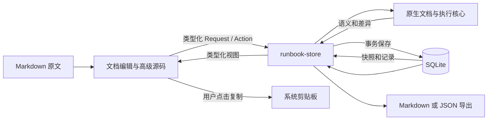

# Runbook 整体架构

本文描述已交付版本，仅作下一阶段的历史参考。新方案暂定采用结构化 JSON 内容、简化清单交互和可配置的可选 AI 扩展，不要求兼容 Markdown、旧数据格式或本页既有架构，见 [ADR 0008](../../../decisions/0008-json-content-and-optional-ai.md)。新方案尚未实施。

Runbook 采用 Tauri 2 桌面壳、React 界面和 Rust 本地业务核心。Markdown 语义解析、执行状态规则和数据库写入由原生侧负责，前端负责编辑、展示和用户操作。核心工作流不启动本地 HTTP 服务，也不依赖网络。

以下为 V0.1 当前实现结构。独立仓储、关系列加 JSON payload 与嵌套备份的实施调整见 [ADR 0004](../../../decisions/0004-store-and-nested-backup.md)；最终构建与 Windows 验证结果由项目 README 和实施规划维护。

## 工程目录

```text
runbook/
├─ README.md
├─ apps/
│  └─ desktop/
│     ├─ src/                         # App、EditorWorkspace、ExecutionWorkspace、Preview
│     └─ src-tauri/                   # Tauri 配置、能力声明和 Windows 集成
│        └─ src/
│           ├─ lib.rs                 # IPC、状态锁、文件对话框与导出写入
│           └─ report.rs              # Markdown 执行报告
├─ packages/
│  ├─ core/
│  │  └─ contracts/                   # Rust DTO 生成的 TS 类型与少量调用类型
│  ├─ markdown/
│  │  └─ editor/                      # 可视化投影、CodeMirror 与源码变换
│  └─ client/
│     ├─ desktop-api/                 # 类型化 invoke 与保存队列
│     └─ ui/                          # Tailwind 与 shadcn/ui 基础组件
├─ native/
│  ├─ runbook-core/                   # 文档语义、状态规则、DTO、数据包校验
│  └─ runbook-store/                  # 用例、事务、schema 2、幂等回执和备份
├─ docs/
│  ├─ prd.md
│  ├─ interaction.md
│  ├─ architecture.md
│  ├─ subsystems/                     # 文档、执行和存储模型
│  └─ decisions/                      # 架构决策及其依据
├─ examples/                         # 非真实环境的文档样例
├─ scripts/                          # 项目内工具链环境与开发命令入口
├─ pnpm-workspace.yaml               # apps/*、packages/*/*
└─ Cargo.toml                        # core、store、desktop 三个 Rust crate
```

早期外部工程参考不随源码分发；当前目录和工具链见[开发说明](../../../../CONTRIBUTING.md)。

桌面 Rust 项目保留 `src-tauri`、配置与 capabilities 等 Tauri 目录约定，整体嵌入 `apps/desktop`。这是对官方项目结构的组织调整。[Tauri 项目结构](https://v2.tauri.app/start/project-structure/)

包为私有 ESM workspace，跨包通过包名引用。四个 TypeScript 功能包与三个 Rust crate 已建立；依赖由 pnpm-lock.yaml 和 Cargo.lock 锁定。仓储可以独立于 Tauri 窗口进行数据库测试。Vite 服务仅用于开发，产品运行不需要本地 HTTP 服务。

## 模块职责

| 模块 | 负责 | 不承担 |
| --- | --- | --- |
| React 场景 | 列表、编辑模式、执行卡片、历史与错误反馈 | SQL、持久化状态裁决 |
| markdown/editor | 可视化编辑与原文投影、选区转换、整步移动、复制生成 ID、UTF 位置换算 | 持久化文档的最终语义解释 |
| client/desktop-api | 类型化 IPC、全局串行保存队列、确认状态与关闭保护 | SQL 拼装或文件全局访问 |
| core/contracts | IPC DTO 与固定枚举的 TypeScript 表达 | 手写第二套执行状态机 |
| native/runbook-core | 标记解析、指令抽取、步骤差异、状态汇总、导入校验 | Tauri、数据库连接、界面 |
| native/runbook-store | 用例、实例创建、revision、回执、事务、查询与备份 | 窗口、文件对话框、进程执行 |
| Tauri 壳 | IPC 调度、本地数据目录、单实例、文件读写与报告 | 业务状态裁决、任意 SQL |

Rust DTO 是跨进程数据定义的权威，两个 crate 的生成器通过 ts-rs 输出 generated.ts 与 actions.ts。生成文件不可手工补字段。模型位于 runbook-core/src/model.rs，操作契约位于 runbook-store/src/request.rs；字段和枚举使用 snake_case，计数及 revision 使用 u32。类型生成不代替原生运行时校验。

## 最小数据流



模板有效文档通过原生校验后保存。创建实例将有效文档及来源元数据复制到不可变初始快照，同时建立独立工作文档。实例源码应用时，同一事务更新文档、步骤投影和内容版本；结果写入时，同一事务更新本轮记录并返回新汇总。完整关系见[执行记录模型](subsystems/execution.md)与[本地存储模型](subsystems/storage.md)。

默认可视化编辑使用 Tiptap/ProseMirror 和 Runbook 自定义节点，编辑树为 Markdown 的前端投影。适配器保存原文片段与签名，未改内容和未知块原样回写；CodeMirror 保留为高级源码入口。选择与约束见 [ADR 0007](../../../decisions/0007-visual-editor-markdown-projection.md)。

CodeMirror/Lezer 语法树用于编辑辅助，顶层注释节点为 CommentBlock；最终步骤由 Rust 使用 pulldown-cmark 解析。原生只解释顶层合法标记，排除围栏、引用、列表、普通 HTML 和行内假标记。指令从原文切片提取，保留空白与 CRLF/LF，仅去除一个围栏结构换行。

Rust 范围按 UTF-8 字节计数，CodeMirror 按 UTF-16；editor 包集中换算。步骤范围包含成对标记，指令范围包含围栏。当前 Document 带 source_hash，不另带 revision；界面核对解析请求原文仍等于当前原文，并在步骤变换前重新解析。持久化对象 revision 与 applied_revision 负责并发和已应用版本，不能把范围当身份。

## 原生接口

当前固定 IPC 为 load_workspace、perform、parse_markdown、plain_markdown、export_backup、export_report、preview_import、pick_import、save_export。perform 接收 Request { operation_id, expected_revision, action }，Action.type 明确区分 create_template、save_template、create_run、save_run_draft、apply_run_draft、begin_attempt、save_attempt、finish_attempt、annotate_attempt、close_run、import_bundle 等用例；完整定义以生成契约为准。读取和写入返回完整 Workspace，尚无分页详情接口。

已有对象写操作携带 operation_id 和 expected_revision，新建与导入不要求旧 revision。先查持久化回执，再校验版本；相同操作 ID 和业务参数只产生一次效果，重试返回当前 Workspace，避免旧响应覆盖新状态。不同参数复用操作 ID 会拒绝。旧 revision 报错，输入保留供用户处理。

前端使用全局串行写队列，原生通过 Arc<Mutex<Store>> 串行访问单连接。数据库与主要文件操作使用 spawn_blocking。每次写操作当前加载、upsert 并返回完整工作区，适用于小规模本地初版；尚无增量保存或大量历史下的性能保证。

## 参数与实例隔离

模板与实例共用编辑器和 Markdown 标记转换。参数定义保存在各自 Markdown 的顶层 JSON 注释中；`parse_markdown` 解析原始结构供编辑定位，新增 `resolve_document` 将本对象参数做单次字面替换并返回有效文档及步骤投影。前端不独立定义替换语义。

创建实例复制来源文档与本次参数；保存实例草稿、应用、记录轮次和再次使用实例均只访问该实例拥有的数据。每轮冻结已替换步骤和参数。模板关联只提供来源展示及显式“从原模板重新开始”，不用于刷新已有实例。版本与数据库升级见 [ADR 0006](../../../decisions/0006-parameters-and-independent-instances.md)。

## 本地能力与数据位置

SQLite 由 Rust 仓储通过 rusqlite 管理，前端不加载 SQL 插件。Tauri SQL 插件本身提供 JavaScript SQL 接口；本项目选择命名业务操作，是为了将步骤应用、轮次与历史保护集中在原生事务中。[Tauri SQL 插件](https://v2.tauri.app/plugin/sql/)

数据库 runbook.sqlite3 默认位于 Tauri 应用本地数据目录。RUNBOOK_DATA_DIR 测试覆盖优先于 EXE 同目录 runbook.local.json 的 dataDirectory 配置，最后才解析系统默认目录；显式配置无效时停止启动，避免意外切换空库。当前开发副本因 AppData 拒绝访问，明确配置为工程根 .local-data，SQLite 与 WebView 缓存共用该数据根。启动失败使用原生弹窗和技术日志，详见 [ADR 0005](../../../decisions/0005-explicit-data-directory.md)。当前没有自动恢复文件或定时数据库备份。应用使用单实例和一个主窗口。导入导出路径通过原生文件对话框获取，导出先写同目录临时文件并同步，再替换目标。

主窗口只启用所需的剪贴板、对话框和窗口能力，不注册 shell 或 process 执行能力。capabilities 按窗口限定；应用自定义 IPC 的调用来源与业务参数仍需单独校验，不能将插件权限配置当作业务校验。[Tauri capabilities](https://v2.tauri.app/security/capabilities/)

Markdown 预览和回显按文本呈现，跳过原始 HTML，图片使用占位文本；链接只显示文字和地址提示，当前没有外部打开入口。复制成功后才显示“已复制”。

## 验证分层

原生核心定向测试覆盖标记范围、精确文本、内容版本、草稿保护、更正链和伪造快照拒绝；仓储集成测试覆盖事务、幂等、冲突、恢复及整包导入；编辑器测试覆盖边界空白、CRLF、重复 ID、复制和取消标记。Windows 剪贴板、文件对话框、退出刷新与恢复的实际验证结果需独立记录。

数据库目前使用 schema 2，支持 schema 1 升级前的 SQLite 一致性备份，并拒绝更高版本。JSON 导出版本 2 覆盖整个工作区，兼容导入版本 1，没有对象选择备份。没有独立持久化 parser_version；未来改变解析语义或备份结构前须继续补充版本和升级测试。验收以[产品需求](prd.md)为准，实际验证及限制见实施记录。
