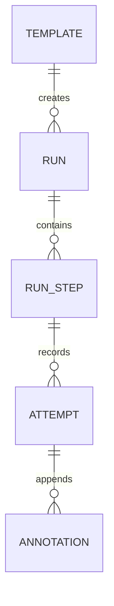

# Runbook 执行记录模型

执行实例拥有独立的文档与结果。模板只提供创建时的内容，实例不向模板写回调整或状态。

## 对象关系

模板到实例的关系表示来源，实例不依赖模板存在。每个实例同时保留不可变的初始模板快照、当前已应用 Markdown 和可自动保存的编辑草稿。模板来源包括名称、标识、revision 与内容；复制或导入后的实例也能独立查看。

参数化实例另外保存自己的已应用参数和草稿参数；参数定义包含在它自己的 Markdown 中。初始快照保存创建时参数，操作轮次保存当轮参数与已替换指令。模板变化不会刷新这些值。再次使用此实例复制本实例自己的文档和参数，只清空执行数据；从原模板重新开始才读取模板当前内容。

步骤由当前有效文档派生，使用稳定 ID。已移除步骤保留在实例的历史集合内，退出当前进度统计。每轮记录冻结其开始时的步骤正文、标题、指令列表、内容版本和文档 revision。

## 步骤状态

| 状态 | 含义 |
| --- | --- |
| pending | 当前内容版本尚无有效结果，界面显示待处理 |
| active | 当前内容版本有正在填写的草稿轮次，界面显示记录中 |
| completed | 最新轮次及其更正结果为完成 |
| failed | 最新轮次及其更正结果为失败 |
| skipped | 最新轮次及其更正结果为跳过 |

状态取当前内容版本的最新轮次，再应用该轮次的最后一条结果更正。当前内容没有轮次，或最新轮次已作废时为 pending。旧内容的成功和较早轮次的成功不能抵消当前失败或待处理状态。

只有用户结果操作能产生完成、失败或跳过。复制、查看、保存回显和启动应用均不能推断结果。不同步骤可同时有草稿记录，每个步骤至多一轮草稿。

## 记录轮次

| 状态 | 可操作范围 |
| --- | --- |
| draft | 修改本轮回显和说明，结束或作废记录 |
| completed | 只读，允许追加说明、更正结果或再次记录 |
| failed | 只读，允许追加说明、更正结果或重试 |
| skipped | 只读，允许追加说明、更正结果或再次记录 |
| withdrawn | 作废的记录，只读保留，不表示外部命令被撤销 |

点击开始记录或首次填写结果内容创建 draft。直接标记结果时允许在一个事务中创建快照并写入终态。本轮开始时间表示记录创建时间，不能标为外部命令实际启动时间。

重试与再次记录创建新轮次，`attempt_no` 在步骤内递增，冻结当前内容版本。旧轮次的回显不默认复制到新轮次。复制指令不创建轮次，同轮重复复制不增加操作次数。

失败和跳过必须保留非空说明；完成可以没有回显。draft 的回显可以自动保存，结束时将尚未保存的文本与终态一并提交，避免界面结果已保存但最后一次粘贴丢失。

## 结果更正与追加说明

终态不原地覆盖。追加说明包含原轮次 ID、正文、顺序和记录时间；结果更正另外记录原结果、新结果和原因。更正只接受 completed、failed、skipped，不新建操作轮次。用户看到原始结果和每次更正，而汇总使用最新有效更正。

已留档实例的所有记录只读。若需要改变已留档结论，V0.1 通过独立新实例记录后续操作，不开放留档后编辑。

## 流程调整

有效源码应用时计算步骤差异，并在事务内更新投影。新步骤待处理；移动步骤保留内容版本与结果；正文变化增加内容版本并恢复待处理；移除步骤保留历史，退出当前流程。

实例与模板共用完整编辑器，允许独立编辑正文、指令、顺序、人工检查点与变量。应用操作同时提交源码和参数，以替换后的实际步骤正文判断内容变化。无关参数值变更不增加未受影响步骤的内容版本；参数造成正文变化时，旧成功记录仅属于旧版本。参数草稿不影响当前可复制指令。

正在填写的步骤不能被改内容或移除。调整草稿可以保存，但应用时提示先结束或作废对应轮次。作废保存已有回显，再应用源码，不把旧回显迁移到新内容。

手工删除 UUID 后再转换同样文本会产生新步骤；工具不根据相似文本继承记录。重新启用已移除 ID 时增加内容版本，需要重新确认。

## 汇总与留档

汇总分别统计当前步骤的 completed、failed、skipped、pending 和 active，已移除步骤另列历史数量。进度显示已处理数和总数，同时保留失败与跳过计数；已处理数为 completed、failed、skipped 之和，不能称为成功数。

实例生命周期为 active 或 closed。结束前清理 draft 轮次，使用者可以标记其结果或将记录作废。结束后保存由当前状态计算的摘要及可选总结，冻结文档和所有结果。

未应用的源码草稿必须先应用或明确放弃，再留档；实例结束时不携带另一份尚未确认的执行流程。

参数草稿与源码草稿遵循相同规则，放弃时一起恢复已应用值，留档前两者均须确认。正常退出保存参数草稿，重新打开不自动应用。

是否存在未应用源码通过草稿与有效源码的实际内容比较判断，不能用对象 `revision` 与 `applied_revision` 不同来判断：结果和注释写入也会增加对象 revision。

| 留档结论 | 判定顺序 |
| --- | --- |
| no_steps | 当前流程没有步骤 |
| failed | 存在当前失败步骤，同时展示其余计数 |
| incomplete | 无当前失败，但仍有待处理步骤 |
| completed_with_skips | 所有当前步骤都有结果，且含跳过 |
| completed | 当前步骤非空且全部完成 |

存在失败和待处理时结论显示含失败，计数同时显示未完成。报告保留历史失败、作废记录和更正，当前结论只基于当前流程，不隐藏历史异常。

关闭窗口只是暂停使用，不结束实例。恢复时继续显示 draft 与未应用源码，不自动完成、作废或新增轮次。
